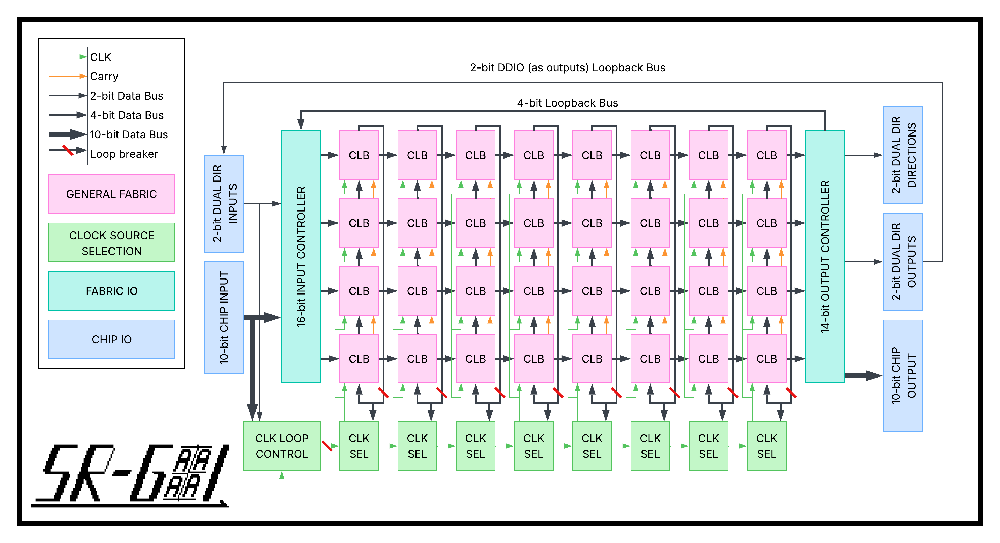
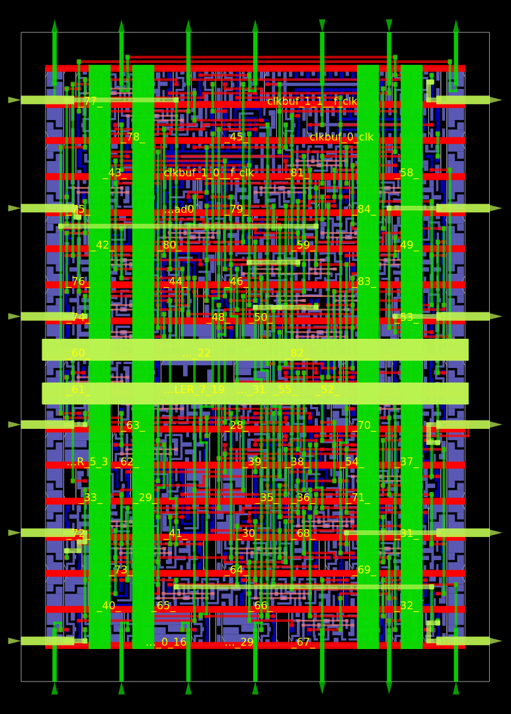

<!---

This file is used to generate your project datasheet. Please fill in the information below and delete any unused
sections.

You can also include images in this folder and reference them in the markdown. Each image must be less than
512 kb in size, and the combined size of all images must be less than 1 MB.
-->

# How it works: an FPGA-lite device
My project is a small FPGA/CPLD-like device which I am calling the SR-GA1 (GA = gate array).
It consists of a 8x4 grid of configurable logic blocks (CLBs) as well as some clock routing logic
and basic IO control.

 - 32 configurable Logic Blocks (CLBs) in an 8x4 array.
 - 8 column clock controllers which can be chained together or sourced from the FPGA fabric
 - 2 dual direction IO pins with fabric controlled directions.
 - Supports column carry chains to easily build up-to-4-bit adders.
 - Simple shift in programming interface.
 - Output protection and anti-oscillation measures for use during programming.

# The CLB

 - Configurable as a LUT3 (represents 256 distinct logic functions) or 1 bit full adder.
 - 3 input multiplexers from which inputs can be selected from various input sources.
 - Column carry chains with dedicated carry generation logic.
 - 8 output multiplexers which determine the signals propagated to the CLBs above and to the right.
 - 1 synchronously resettable D flip-flop with a fixed enable line and a shared column clock.
 - 25 configuration flip-flops give over 32 million possible configurations.

# Programming
1) Assert reset after setting shift_data_in to 0
2) Send bitstream including high start bit to freeze outputs when programming via shift_clk (positive edge clocked) and shift_data_in
3) Deassert reset to unfreeze the outputs and allow internal oscillation
If combinational: PROGRAMMING SEQUENCE END
If synchronous requiring reset: CONTINUE
4) Assert reset
5) Clock the relevant flip-flops
6) Deassert reset
PROGRAMMING SEQUENCE END

Data is shifted in via fixed input 0 whilst being clocked with the system clock. The FPGA configuration shift register
has no resets (to save space) so configuration is required every time it is powered up. 
The reset pin is used to reset the data registers and is synchronous to the relevant CLB column clock.

## How to test

First use my [FPGA programming software](https://github.com/SRB2149/SR-GA1) (currently out of date)
to create a design and then export the generated bitstream. Copy that bitstream to the RP2040
and use my programmer script (not made yet) to setup the FPGA for use. Then drive the IO as you wish.

## External hardware

You will need a computer which can run my FPGA programming software 
(see my main [SR-GA1 Github](https://github.com/SRB2149/SR-GA1))
to create the bitstream which can then be shifted into the FPGA. 
Beyond that, nothing is needed.